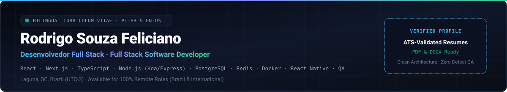

  

 

  
  
  
  

  <a href="#-english-resume-en-us"><strong>🇺🇸 English Resume (EN-US)</strong></a>
  &nbsp;·&nbsp;
  <a href="#-currículo-em-português-pt-br"><strong>🇧🇷 Currículo em Português (PT-BR)</strong></a>
  &nbsp;·&nbsp;
  <a href="./pdf/Rodrigo_Souza_Feliciano_Resume_en-US_onepage.pdf"><strong>📄 1-Page PDF (EN-US)</strong></a>
  &nbsp;·&nbsp;
  <a href="./pdf/Rodrigo_Souza_Feliciano_Curriculo_pt-BR_onepage.pdf"><strong>📄 PDF 1 Página (PT-BR)</strong></a>

---

# 🇺🇸 English Resume (EN-US)

**Rodrigo Souza Feliciano**  
**Full Stack Software Developer | QA Analyst**  
Laguna, SC, Brazil (`UTC-3`) · Available for 100% remote roles, in Brazil and abroad  
[rodrigo.souza.f3liciano@gmail.com](mailto:rodrigo.souza.f3liciano@gmail.com) · [+55 (48) 99926-3583](https://wa.me/5548999263583) · [LinkedIn](https://linkedin.com/in/rodrigosouzafeliciano) · [GitHub](https://github.com/rodrigosouzafeliciano) · [Portfolio](https://portfolio-rodrigo-pink.vercel.app)

### Professional Summary

Full stack developer and QA analyst with 1 year and 4 months at Orbe Soft, working in web development, regression test planning, and Tier 2/3 (`N2/N3`) technical support. Builds Node.js and PostgreSQL backends, React and Next.js interfaces, and React Native apps. Designed Kanghoo, a school transport platform with real-time GPS telemetry. Also works as an independent developer.

### Technical Skills

- **Languages:** TypeScript, JavaScript (ES6+), Python
- **Frontend and Mobile:** React.js, Next.js, React Native, Vite, Tailwind CSS, HTML5, CSS3, component-driven architecture, responsive design
- **Backend and Real-Time:** Node.js, Express.js, Koa.js, WebSockets, Socket.IO, Awilix, JWT, Bcrypt, Clean Architecture, REST APIs
- **Databases and Caching:** PostgreSQL, Redis, relational modeling, optimized queries
- **DevOps and Observability:** Docker, Docker Compose, Nginx, Prometheus, Grafana, Linux, Git, GitHub, CI/CD, reverse proxy and SSL/TLS, dev and prod environment parity
- **Quality Assurance and Testing:** Functional testing, regression testing, user acceptance testing (UAT), bug lifecycle with severity, coverage and traceability matrices
- **Data and Machine Learning (academic and practical):** TensorFlow, Pandas, NumPy, Matplotlib, Seaborn, exploratory data analysis, business metric visualization
- **No-Code and Requirements:** Webflow, BPMN, UML, traceability matrices, document management

### Professional Experience

#### Orbe Soft
**Software Developer & QA Analyst** · Remote · `May 2025 - Aug 2026` *(1 year 4 months)*  
*Stack: Next.js, TypeScript, Tailwind CSS, React.js, Node.js, Webflow, Git*

- **Web development:** Built and shipped conversion-focused landing pages and web applications with Next.js, TypeScript, and Tailwind CSS, using a component-driven architecture with attention to load performance.
- **Webflow portals:** Implemented and published corporate institutional portals in Webflow for energy-sector clients, reducing interface delivery time while keeping integration with existing systems.
- **Test plans:** Structured and executed functional, regression, and acceptance test plans for critical software flows, aiming for defect-free production releases (zero-defect standard).
- **Bug lifecycle:** Managed the full bug lifecycle (identification, severity-graded documentation, triage, and re-testing after the fix) to prevent regressions in already validated features.
- **Traceability:** Created coverage and traceability matrices linking functional requirements to executed test cases, reducing the risk of undetected failures in production.
- **Tier 2/3 support (N2/N3):** Diagnosed and resolved production incidents and software failures through log analysis and code debugging, reducing service downtime (MTTR).

#### Independent Developer (Workana and direct consulting)
**Full Stack Developer (Web, Mobile, and Landing Pages)** · Remote · [workana.com/freelancer/rodrigosouzafeliciano](https://www.workana.com/freelancer/rodrigosouzafeliciano)  
*Stack: React.js, Next.js, React Native, Node.js, Express.js, PostgreSQL, Redis, Tailwind CSS, REST APIs, Git*

- **Full stack applications:** Built full stack web applications and SaaS platform MVPs on demand, from relational database design to reactive React and Next.js interfaces.
- **Mobile apps:** Built cross-platform mobile apps (iOS and Android) with React Native, including native components, REST API consumption, and local data persistence.
- **Landing pages:** Designed landing pages with technical SEO, microinteractions, and asset optimization using Tailwind CSS, aiming to maximize the Google Lighthouse performance score.
- **Integrations:** Integrated third-party systems and payment gateways through REST APIs, with data validation to avoid transactional inconsistencies.

### Projects

#### Kanghoo: School Transport Management Platform
**Full Stack Developer and Architect** · Capstone project and standalone product · `Feb 2025 - Dec 2025`  
Repository: [github.com/rodrigosouzafeliciano/projeto-sistema-kanghoo](https://github.com/rodrigosouzafeliciano/projeto-sistema-kanghoo)  
*Stack: Node.js, Koa.js, PostgreSQL, Redis, Socket.IO, Docker, Nginx, Prometheus, Grafana, Awilix, JWT, Bcrypt*

- **Architecture:** Designed the backend with Clean Architecture (Domain, Application, Infrastructure, Interface) and Awilix dependency injection, isolating business rules across more than 23 routes and controllers.
- **Database:** Modeled the PostgreSQL relational schema for school routes, student boarding and alighting confirmation, and hierarchical access profiles (drivers, guardians, and administrators).
- **Security:** Implemented JWT authentication, Bcrypt password hashing, and rate-limiting middleware to mitigate brute-force attacks and request overload.
- **Real time:** Implemented real-time GPS telemetry with WebSockets (Socket.IO) and Redis caching, continuously updating vehicle positions with low network latency.
- **Containers:** Containerized the services (API, database, cache, proxy, and monitoring) with Docker and Docker Compose, keeping development and production environments in parity.
- **Observability:** Integrated Prometheus (metrics) and Grafana to visualize node health in real time.

#### Personal Portfolio
[portfolio-rodrigo-pink.vercel.app](https://portfolio-rodrigo-pink.vercel.app) · [github.com/rodrigosouzafeliciano/portfolio-rodrigo](https://github.com/rodrigosouzafeliciano/portfolio-rodrigo)  
Responsive, modular site presenting project cases, with attention to Lighthouse performance.

### Education

- **Universidade Pitágoras Unopar Anhanguera, Brazil**  
  **Technologist Degree (Superior de Tecnologia) in Systems Analysis and Development (ADS)** · `2,200 h` · `Aug 2026 - Dec 2028 (expected)`  
  - Coursework: Software Engineering, Data Modeling, Cloud Computing, Testing Quality and Automation  
  - Completed: Programming Language course (Python), grade 100/100; data analysis and visualization with Pandas, Matplotlib, and Seaborn; supervised Machine Learning classification (TensorFlow)
- **SENAC (Serviço Nacional de Aprendizagem Comercial), Brazil**  
  - **Programador Web (Professional Qualification)** · `240 h` · `Jul 2025 - Dec 2025` (Full stack web development with production deployment, ending with the Projeto Integrador)  
  - **Programador de Sistemas (Professional Qualification)** · `200 h` · `Feb 2025 - Jul 2025` (Systems analysis, databases, testing and maintenance; development of the Kanghoo project)  
  - **Assistente Administrativo (Professional Qualification)** · `160 h` · `Aug 2020 - Dec 2020` (Organization of corporate processes, and drafting and control of organizational documents)

### Languages

- **Portuguese:** Native
- **English:** Upper-intermediate (B2+). Technical reading, documentation writing, and professional conversation. Workana English Test (2026): 93%.
- **Spanish:** Basic

---
---

# 🇧🇷 Currículo em Português (PT-BR)

**Rodrigo Souza Feliciano**  
**Desenvolvedor de Software Full Stack | Analista de QA**  
Laguna, SC, Brasil (`UTC-3`) · Disponível para posições 100% remotas, no Brasil e no exterior  
[rodrigo.souza.f3liciano@gmail.com](mailto:rodrigo.souza.f3liciano@gmail.com) · [+55 (48) 99926-3583](https://wa.me/5548999263583) · [LinkedIn](https://linkedin.com/in/rodrigosouzafeliciano) · [GitHub](https://github.com/rodrigosouzafeliciano) · [Portfólio](https://portfolio-rodrigo-pink.vercel.app)

### Resumo Profissional

Desenvolvedor full stack e analista de QA com 1 ano e 4 meses na Orbe Soft, atuando em desenvolvimento web, planos de teste de regressão e suporte técnico `N2/N3`. Desenvolve back-ends em Node.js e PostgreSQL, interfaces em React e Next.js e aplicativos em React Native. Projetou o Kanghoo, plataforma de transporte escolar com telemetria GPS em tempo real. Atua também como desenvolvedor independente.

### Competências Técnicas

- **Linguagens:** TypeScript, JavaScript (ES6+), Python
- **Front-end e mobile:** React.js, Next.js, React Native, Vite, Tailwind CSS, HTML5, CSS3, arquitetura orientada a componentes, design responsivo
- **Back-end e tempo real:** Node.js, Express.js, Koa.js, WebSockets, Socket.IO, Awilix, JWT, Bcrypt, Clean Architecture, REST APIs
- **Bancos de dados e cache:** PostgreSQL, Redis, modelagem relacional, consultas otimizadas
- **DevOps e observabilidade:** Docker, Docker Compose, Nginx, Prometheus, Grafana, Linux, Git, GitHub, CI/CD, proxy reverso e SSL/TLS, paridade entre ambientes dev e prod
- **Qualidade e testes (QA):** Testes funcionais, testes de regressão, testes de aceitação (UAT), ciclo de vida de bugs com severidade, matrizes de cobertura e rastreabilidade
- **Dados e Machine Learning (acadêmico e prático):** TensorFlow, Pandas, NumPy, Matplotlib, Seaborn, análise exploratória de dados, visualização de métricas de negócio
- **No-code e requisitos:** Webflow, BPMN, UML, matrizes de rastreabilidade, gestão documental

### Experiência Profissional

#### Orbe Soft
**Software Developer & QA Analyst** · Remoto · `mai. 2025 - ago. 2026` *(1 ano e 4 meses)*  
*Tecnologias: Next.js, TypeScript, Tailwind CSS, React.js, Node.js, Webflow, Git*

- **Desenvolvimento web:** Desenvolveu e publicou landing pages de conversão e aplicações web com Next.js, TypeScript e Tailwind CSS, com arquitetura de componentes e atenção ao desempenho de carregamento.
- **Portais em Webflow:** Implementou e publicou portais institucionais corporativos em Webflow para clientes do setor de energia, reduzindo o tempo de entrega e mantendo a integração com sistemas existentes.
- **Planos de teste:** Estruturou e executou planos de teste funcionais, de regressão e de aceitação para fluxos críticos de software, com foco em releases de produção sem defeitos (padrão zero-defeito).
- **Ciclo de vida de bugs:** Administrou o ciclo completo de tratamento de bugs (identificação, documentação por severidade, triagem e re-teste após a correção) para evitar regressões em funcionalidades já validadas.
- **Rastreabilidade:** Criou matrizes de cobertura e de rastreabilidade ligando requisitos funcionais aos casos de teste executados, reduzindo o risco de falhas não detectadas em produção.
- **Suporte N2/N3:** Diagnosticou e resolveu incidentes e falhas de software em produção por meio de análise de logs e depuração de código, reduzindo o tempo de indisponibilidade dos serviços (MTTR).

#### Desenvolvedor Independente (Workana e consultoria direta)
**Desenvolvedor Full Stack (Web, Mobile e Landing Pages)** · Remoto · [workana.com/freelancer/rodrigosouzafeliciano](https://www.workana.com/freelancer/rodrigosouzafeliciano)  
*Tecnologias: React.js, Next.js, React Native, Node.js, Express.js, PostgreSQL, Redis, Tailwind CSS, REST APIs, Git*

- **Aplicações full stack:** Desenvolveu aplicações web full stack e MVPs de plataformas SaaS sob demanda, da modelagem do banco de dados relacional às interfaces reativas em React e Next.js.
- **Aplicativos mobile:** Construiu aplicativos móveis multiplataforma (iOS e Android) com React Native, com componentes nativos, consumo de APIs REST e persistência local de dados.
- **Landing pages:** Projetou landing pages com SEO técnico, microinterações e otimização de assets com Tailwind CSS, com foco em maximizar o índice de desempenho no Google Lighthouse.
- **Integrações:** Integrou sistemas de terceiros e gateways de pagamento por APIs REST, com validação de dados para evitar inconsistências transacionais.

### Projetos

#### Kanghoo: Plataforma de Gestão de Transporte Escolar
**Desenvolvedor Full Stack e Arquiteto** · Projeto capstone e produto autônomo · `fev. 2025 - dez. 2025`  
Repositório: [github.com/rodrigosouzafeliciano/projeto-sistema-kanghoo](https://github.com/rodrigosouzafeliciano/projeto-sistema-kanghoo)  
*Tecnologias: Node.js, Koa.js, PostgreSQL, Redis, Socket.IO, Docker, Nginx, Prometheus, Grafana, Awilix, JWT, Bcrypt*

- **Arquitetura:** Projetou o back-end com Clean Architecture (Domain, Application, Infrastructure e Interface) e injeção de dependências com Awilix, isolando regras de negócio em mais de 23 rotas e controladores.
- **Banco de dados:** Modelou o esquema relacional em PostgreSQL para rotas, confirmação de embarque e desembarque de alunos e perfis de acesso hierárquicos (motoristas, responsáveis e administradores).
- **Segurança:** Implementou autenticação JWT, criptografia de senhas com Bcrypt e middleware de rate limiting para mitigar ataques de força bruta e sobrecarga de requisições.
- **Tempo real:** Implementou telemetria GPS em tempo real com WebSockets (Socket.IO) e cache em Redis, atualizando continuamente a posição dos veículos com baixa latência de rede.
- **Containers:** Conteinerizou os serviços (API, banco de dados, cache, proxy e monitoramento) com Docker e Docker Compose, mantendo paridade entre os ambientes de desenvolvimento e produção.
- **Observabilidade:** Integrou o Prometheus (métricas) e o Grafana para visualizar a integridade dos nós em tempo real.

#### Portfólio Pessoal
[portfolio-rodrigo-pink.vercel.app](https://portfolio-rodrigo-pink.vercel.app) · [github.com/rodrigosouzafeliciano/portfolio-rodrigo](https://github.com/rodrigosouzafeliciano/portfolio-rodrigo)  
Site responsivo e modular com apresentação de cases, com atenção ao desempenho no Lighthouse.

### Formação

- **Universidade Pitágoras Unopar Anhanguera**  
  **Curso Superior de Tecnologia em Análise e Desenvolvimento de Sistemas (ADS)** · `2.200 h` · `ago. 2026 - dez. 2028 (previsto)`  
  - Áreas: Engenharia de Software, Modelagem de Dados, Computação em Nuvem, Qualidade e Automação de Testes  
  - Concluído: disciplina de Linguagem de Programação (Python) com nota 100/100; análise e visualização de dados com Pandas, Matplotlib e Seaborn; classificação com Machine Learning supervisionado (TensorFlow)
- **SENAC (Serviço Nacional de Aprendizagem Comercial)**  
  - **Programador Web (Qualificação Profissional)** · `240 h` · `jul. 2025 - dez. 2025` (Desenvolvimento web full stack, com deploy em produção e Projeto Integrador)  
  - **Programador de Sistemas (Qualificação Profissional)** · `200 h` · `fev. 2025 - jul. 2025` (Análise de sistemas, banco de dados, testes e manutenção; desenvolvimento do projeto Kanghoo)  
  - **Assistente Administrativo (Qualificação Profissional)** · `160 h` · `ago. 2020 - dez. 2020` (Organização de processos corporativos, elaboração e controle de documentos da organização)

### Idiomas

- **Português:** Nativo
- **Inglês:** Intermediário alto (B2+). Leitura técnica, redação de documentação e conversação profissional. Teste de Inglês Workana (2026): 93%.
- **Espanhol:** Básico
